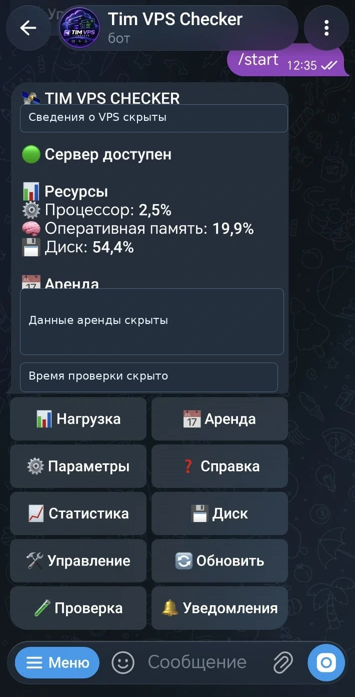
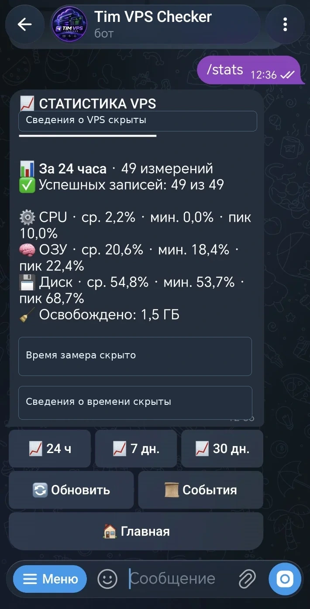
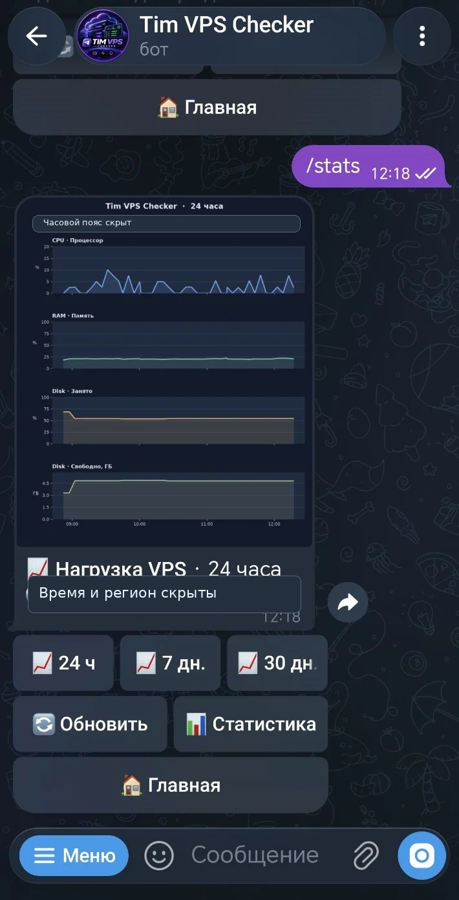
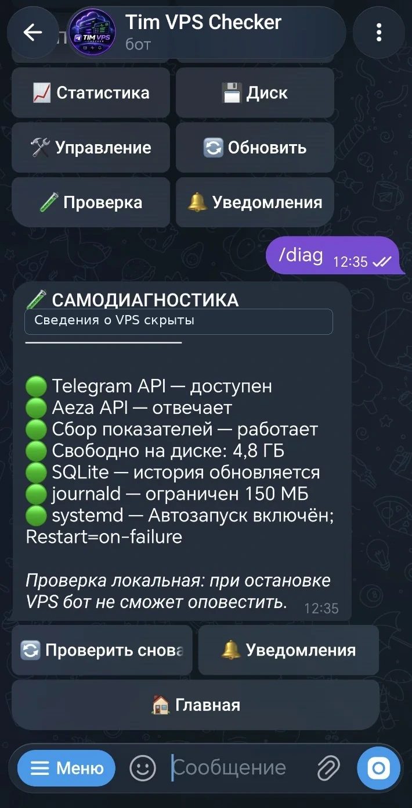
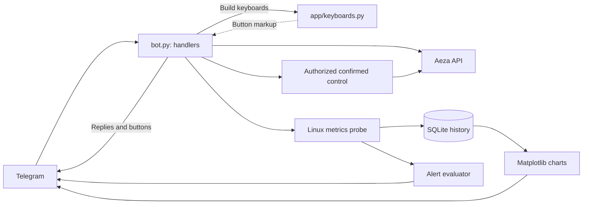

<div align="center">

# 🛰️ Tim VPS Checker

### Your Linux VPS, right in Telegram.

**A personal monitoring and management bot with live metrics, history, graphs, alerts and guarded actions — without keeping an SSH session open.**


[](https://github.com/Timsome1337/tim-vps-checker/actions/workflows/tests.yml)

[Русский](README.md) · [Quick start](#-quick-start) · [Architecture](docs/ARCHITECTURE.md)

</div>

---

## 👋 Why I built it

I run services on a VPS. I used to open an SSH session whenever I wanted to check memory, CPU load, disk space or a systemd service. Rental information lived elsewhere. For quick everyday checks, that was more friction than I wanted.

So I built **Tim VPS Checker**, a small Telegram dashboard for a Linux server I manage. It answers practical questions: **Is it running? What has changed? Is something close to a limit? Is the rental about to expire?**

It is not meant to replace a terminal or a full monitoring platform. It is a convenient first place to look before digging deeper.

## 📱 Screenshots

<div align="center">
  
  
  
  
</div>

> 🔒 Real screenshots from the working bot. Hosting, rental and local-time details have been covered with **opaque redaction boxes** for public sharing. The metrics reflect the capture date, not live server status.

## ✨ What it does

| Feature | How it helps |
| --- | --- |
| **Server overview** | CPU, RAM, disk, uptime, Linux information and availability |
| **History & graphs** | SQLite-backed charts for **24 hours, 7 days and 30 days** |
| **Network statistics** | Interface counters, estimated RX/TX rates and observed traffic deltas |
| **Smart alerts** | Sustained threshold detection, recovery notices and per-user preferences |
| **Services** | Selected systemd service status and change history |
| **Self-diagnostics** | Checks for metric collection, Telegram/Aeza API, SQLite, journald and systemd |
| **Provider integration** | Rental status and expiry when Aeza API is configured |
| **Guarded control** | Authorized, confirmed and rate-limited reboot requests |
| **Audit history** | Measurements, incidents and administrative requests |

A short CPU spike should not immediately trigger a panic message. Alerts are based on repeated observations, and recovery is reported separately.

### A typical workflow

If my VPS feels slow, I open the bot, check its current usage, look at the chart for the past few hours and then decide what to inspect over SSH. **The bot helps me choose the next diagnostic step; it does not pretend to fix the underlying issue automatically.**

## 🧩 Architecture



The bot runs **on the same VPS that it monitors**. The main tools are Python, `python-telegram-bot`, Linux system tools, SQLite, Matplotlib, Aeza API and systemd. Telegram uses long polling, so no inbound webhook port is required.

I kept the runtime deliberately simple: no separate database server or external monitoring node. Keyboard layouts live in `app/keyboards.py`, while the Telegram handlers remain in `bot.py`. See [ARCHITECTURE.md](docs/ARCHITECTURE.md) for module responsibilities.

## 🔧 Design choices

- **SQLite instead of PostgreSQL:** sufficient for the size and scope of a personal monitoring bot.
- **systemd:** standard Linux process supervision, restart behavior and logging.
- **Long polling:** no public inbound HTTP service for Telegram updates.
- **Authorization and confirmation:** a reboot is a protected operation, not a one-tap action.
- **Persistent alert state:** incidents survive bot restarts, while notification delivery has explicitly documented limitations.
- **Offline tests:** core logic and API integration behavior can be tested without changing a real VPS.

## 🚀 Quick start

Use a **test Linux VPS**, Python **3.10+** and your own Telegram bot credentials.

```bash
python3 -m venv .venv
source .venv/bin/activate
python -m pip install -r requirements.txt

cp .env.example .env
cp config.example.yaml config.yaml
chmod 600 .env config.yaml
# Fill in your own Telegram credentials and VPS settings.

python check.py
python bot.py
```

`.env` and `config.yaml` are local-only settings; do not commit them. Reboot access via Aeza is disabled by default. For a dedicated service account and a systemd unit, use [INSTALL.md](docs/INSTALL.md).

**Do not use this public copy as an in-place update over a live production installation without backups and a separate migration plan.**

Telegram commands: `/start`, `/status`, `/specs`, `/disk`, `/network`, `/stats`, `/billing`, `/control`, `/actions`, `/events`, `/diag`, `/alerts`, `/services`, `/help`. Most features are also available from buttons.

## 🧪 Tests and quality

The checked local revision passed **113 automated tests**:

```bash
python -W error::ResourceWarning -m unittest discover -s tests -v
```

GitHub Actions automatically checks Python 3.10, 3.12 and 3.13 on pushes and pull requests. **All three jobs passed on GitHub-hosted runners** ([successful run](https://github.com/Timsome1337/tim-vps-checker/actions/runs/43776576910)). The tests use offline Telegram/Aeza fakes and mocks — **no live credentials or VPS access are needed**. They do not demonstrate real Telegram delivery or a real server reboot.

## ⚖️ Limitations, openly stated

| Decision | Trade-off |
| --- | --- |
| Monitor runs on the VPS itself | No external alert if that VPS goes completely offline |
| Alert state is saved before sending | A failed Telegram delivery can lose a message; there is no durable outbound queue |
| Local SQLite storage | Backups on the same VPS do not cover loss of the entire machine |
| Reboot through provider API | An accepted request does not prove the VPS has finished rebooting |
| Linux network counters | Not equivalent to the provider's billing traffic counters |

`bot.py` still contains most handlers. Splitting them into `handlers/` might be worthwhile as the project grows, but was not necessary for the current scope.

Possible next steps: clean-VM deployment testing, off-server backups, further handler extraction and — if needed — independent external uptime monitoring.
