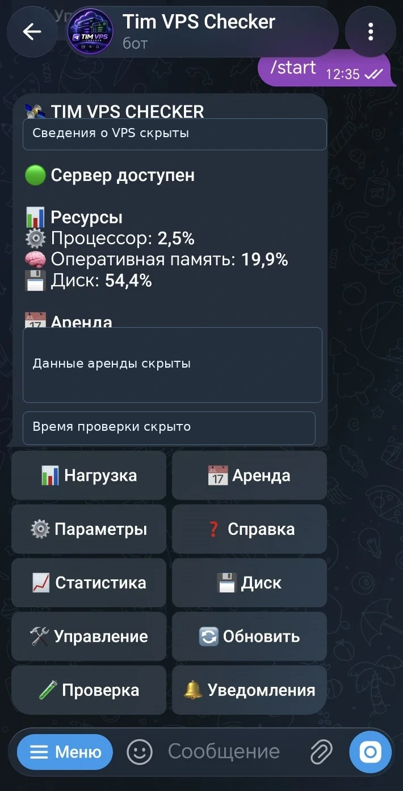
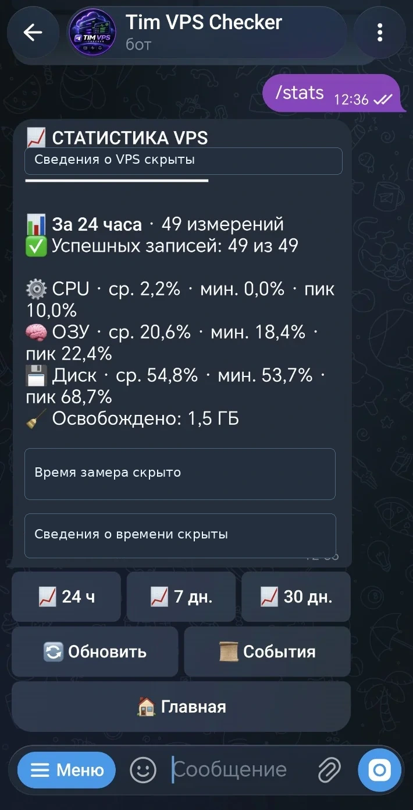
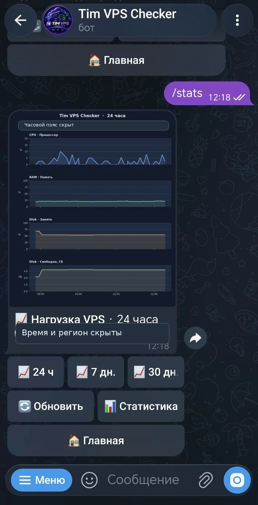
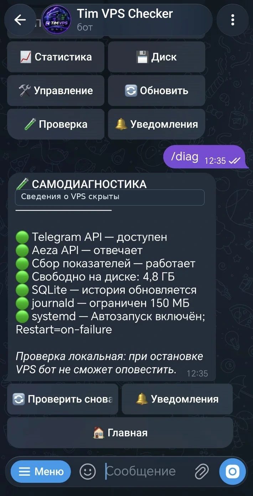
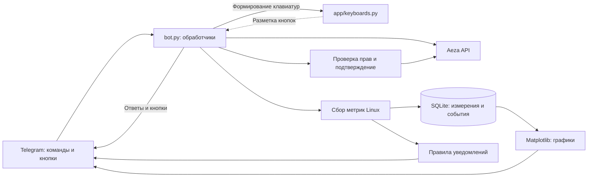

<div align="center">

# 🛰️ Tim VPS Checker

### Сервер под рукой. Прямо в Telegram.

**Мониторинг Linux VPS, история нагрузки, уведомления и управление — без отдельной панели и постоянных подключений по SSH.**


[](https://github.com/Timsome1337/tim-vps-checker/actions/workflows/tests.yml)

[English](README.en.md) · [Возможности](#-что-умеет-бот) · [Как запустить](#-быстрый-старт) · [Архитектура](docs/ARCHITECTURE.md)

</div>

---

## 👋 Что это за проект

У меня есть VPS, на котором работают собственные сервисы. Проверять, всё ли с ним в порядке, поначалу было не очень удобно: подключиться по SSH, посмотреть нагрузку, память, место на диске, открыть логи, отдельно проверить срок аренды.

**Я захотел собрать эти повседневные действия в одном месте — в Telegram, который и так всегда под рукой.** Так появился **Tim VPS Checker**: небольшой личный пульт управления Linux-сервером.

Бот не пытается заменить терминал или полноценный комплекс мониторинга. Он отвечает на обычные практические вопросы:

- Сервер вообще работает?
- Не заканчивается ли память или место на диске?
- Какая нагрузка была несколько часов назад, а не только сейчас?
- Что произошло с отслеживаемой службой?
- Пора ли продлевать аренду?
- Можно ли безопасно запросить перезагрузку, если она действительно нужна?

Всё это доступно через понятные кнопки. Под капотом — Python, метрики Linux, SQLite, графики Matplotlib, Telegram API и интеграция с Aeza.

## 📱 Как это выглядит

<div align="center">
  
  
  
  
</div>

> 🔒 Это **настоящие скриншоты работающего бота**. Сведения о размещении сервера, аренде и локальном времени закрыты непрозрачными плашками для публичного портфолио. Показанная статистика относится к моменту съёмки, а не к текущему состоянию VPS.

## ✨ Что умеет бот

| Возможность | Что получаю в Telegram |
| --- | --- |
| **Состояние VPS** | Доступность, процессор, ОЗУ, диск, системные параметры и uptime |
| **Графики нагрузки** | Историю за **24 часа, 7 и 30 дней**, а не только мгновенные цифры |
| **Сеть** | Счётчики интерфейса, приём/передачу и рассчитанный трафик за наблюдаемые интервалы |
| **Умные предупреждения** | Сообщения о продолжительных отклонениях и последующем восстановлении |
| **Личные настройки** | Возможность включать и отключать категории уведомлений для отдельных разрешённых пользователей |
| **Состояние служб** | Статусы выбранных systemd-сервисов и историю их изменений |
| **Диагностика** | Проверки Telegram API, Aeza API, сбора метрик, SQLite, журналов и автозапуска |
| **Аренда VPS** | Сведения от провайдера о сроке и стоимости при настроенной интеграции |
| **Управление** | Запрос перезагрузки с проверкой прав, подтверждением и защитой от повторов |
| **История событий** | Записи измерений, событий и административных запросов |

**Уведомления без лишнего шума.** Кратковременный скачок CPU сам по себе не должен превращаться в тревогу: система учитывает последовательные измерения и сообщает, когда показатель восстановился. Отдельные проверки предусмотрены для малого остатка дискового пространства, состояния служб и срока аренды.

### Пример обычного использования

Представим, что VPS начал тормозить. Вместо того чтобы сразу подключаться по SSH, я открываю бота: смотрю текущую нагрузку, затем статистику и график. Если проблему видно за последние часы, перехожу к диагностике или уже изучаю сервис через терминал. **Бот помогает быстрее понять, куда смотреть, но не выдаёт себя за полноценную замену диагностики Linux.**

## 🧩 Как он устроен



Вместо большой внешней инфраструктуры используется **одно приложение на том же VPS**, которым оно управляет:

- **Python + python-telegram-bot:** команды, кнопки, фоновые проверки и ответы.
- **Linux:** системные показатели, службы, диагностика процессов и ресурсов.
- **SQLite:** история измерений, события и пользовательские настройки.
- **Matplotlib:** графики по сохранённым данным.
- **Aeza API:** получение сведений об аренде и подтверждённый запрос перезагрузки.
- **systemd:** работа бота как службы и автоматический перезапуск при ошибке.

Клавиатуры вынесены в `app/keyboards.py`, сбор и хранение данных — в отдельные модули `app/`. Обработчики Telegram пока живут в `bot.py` — это сознательно оставленное направление для дальнейшего рефакторинга.

Подробная схема и роли файлов — в [ARCHITECTURE.md](docs/ARCHITECTURE.md).

## 🔧 Несколько инженерных решений, которыми я доволен

**Один сервер — простая эксплуатация.** Для личной задачи SQLite и systemd оказались практичнее отдельной базы данных и сложного набора сервисов. Это уменьшает количество компонентов, которые сами могут выйти из строя.

**Бот не требует открывать входящий порт.** Telegram работает через long polling: для обычной работы нужен исходящий интернет, а не публичный webhook.

**Опасные действия не выполняются в одно нажатие.** Запрос перезагрузки проходит проверку полномочий, подтверждение и ограничение частоты; сам HTTP-запрос к провайдеру отделён от простого просмотра метрик.

**Состояние предупреждений сохраняется между перезапусками.** Это помогает не начинать историю инцидентов заново при каждом рестарте процесса. При этом я честно учитываю ограничение доставки Telegram-сообщений — оно описано ниже.

**Есть автоматические тесты.** Они проверяют метрики, SQLite, уведомления, доступ, Aeza API и интерфейс через локальные заглушки, не отправляя реальные команды на VPS.

## 🚀 Быстрый старт

> Пример рассчитан на **собственный тестовый Linux VPS**. Публичная копия не предназначена для замены кода поверх уже работающей установки без отдельной миграции и резервного копирования.

Нужны Python **3.10+**, собственный Telegram-бот и возможность установить зависимости.

```bash
python3 -m venv .venv
source .venv/bin/activate
python -m pip install -r requirements.txt

cp .env.example .env
cp config.example.yaml config.yaml
chmod 600 .env config.yaml
# Укажи собственный Telegram-токен, Telegram ID и параметры VPS.

python check.py
python bot.py
```

В `.env` находятся секреты и разрешённые Telegram ID, в `config.yaml` — параметры мониторинга. Эти файлы не нужно загружать в GitHub. Пример `config.example.yaml` использует условные данные.

Постоянный запуск через отдельного пользователя и systemd разобран в [INSTALL.md](docs/INSTALL.md). Управление через Aeza API по умолчанию не включено — его нужно настраивать отдельно и осознанно.

### Telegram-команды

`/start` · `/status` · `/specs` · `/disk` · `/network` · `/stats` · `/billing` · `/control` · `/actions` · `/events` · `/diag` · `/alerts` · `/services` · `/help`

Большинство действий доступны также через кнопки, поэтому запоминать команды необязательно.

## 🧪 Проверки и качество кода

В проверенной локальной сборке **113 автоматических тестов** завершились успешно. Для повторного запуска:

```bash
python -W error::ResourceWarning -m unittest discover -s tests -v
```

GitHub Actions запускает автоматические проверки на Python 3.10, 3.12 и 3.13 при `push` и `pull_request`. **Все три задания успешно завершились на GitHub-hosted runners** ([успешный запуск](https://github.com/Timsome1337/tim-vps-checker/actions/runs/43776576910)). Тесты работают без реальных ключей и доступа к VPS; они не подтверждают фактическую доставку сообщений Telegram или реальную перезагрузку сервера.

Все автоматические тесты запускаются офлайн: для Telegram и Aeza используются моки и заглушки, поэтому **для проверки не нужны реальные токены, API-ключи или работающий VPS**. При этом они не заменяют сквозное испытание доставки сообщений и перезагрузки сервера.

## ⚖️ Что проект делает — и чего не обещает

Это инструмент для **личного мониторинга**, а не отказоустойчивая внешняя платформа наблюдения.

| Решение | Обратная сторона |
| --- | --- |
| Бот работает на самом VPS | При полном выключении VPS он не сможет предупредить об аварии снаружи |
| Событие тревоги записывается до отправки сообщения | При сбое Telegram доставка может потеряться; гарантированной очереди нет |
| SQLite хранит историю локально | Резервная копия на том же VPS не защищает от потери всей машины |
| Действия выполняются через Aeza API | Принятый запрос перезагрузки **не означает**, что сервер уже успел перезагрузиться |
| Метрики сети читаются из Linux | Они не являются счётчиком тарификации хостинг-провайдера |

Ещё один честный пункт: `bot.py` остаётся довольно крупным. Полностью разбивать его на `handlers/` ради самого рефакторинга я не стал — сначала было важнее стабилизировать интерфейс и выделить клавиатуры. Это возможное дальнейшее улучшение, а не скрываемая проблема.

## 🗺️ Что можно улучшить дальше

- Выделить Telegram-обработчики в отдельные модули, если интерфейс продолжит расти.
- Проверить установку и восстановление **на отдельной тестовой виртуальной машине**.
- Добавить резервное копирование **вне** отслеживаемого VPS.
- При необходимости добавить внешнюю проверку доступности сервера, независимую от самого бота.
