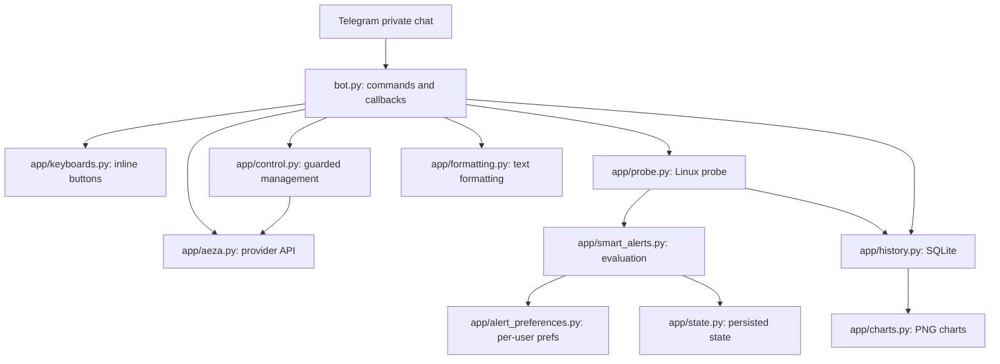

# Архитектура Tim VPS Checker

## Основной поток

## Модули

| Файл | Назначение |
| --- | --- |
| `bot.py` | Telegram-команды, обработчики callback, проверка доступа, циклические задания |
| `app/keyboards.py` | Формирование inline-клавиатур, callback-данных и URL |
| `app/config.py` | Валидация конфигурации и списка служб |
| `app/alert_preferences.py` | Индивидуальные настройки уведомлений в SQLite |
| `app/recovery.py` | Проверка автозапуска и настройки Restart в systemd (без управляющих действий) |
| `app/maintenance.py` | Обслуживание и резервное копирование SQLite |
| `app/probe.py` | Сбор системных показателей Linux локально или по SSH |
| `app/aeza.py` | Чтение аренды и поддерживаемые управляющие запросы провайдера |
| `app/smart_alerts.py` | Подтверждение предупреждений и восстановление |
| `app/state.py` | Атомарное хранение состояния уведомлений |
| `app/history.py` | Измерения, события и журнал запросов SQLite |
| `app/charts.py` | Графики Matplotlib, часовой пояс Europe/Samara |
| `app/control.py` | Подтверждение, срок действия запроса и ограничение частоты перезагрузок |
| `app/formatting.py` | Текст Telegram-сообщений |
| `deploy/vps-monitor.service` | Автозапуск и восстановление процесса |

## Принятые решения и компромиссы

- **Один VPS:** меньше сложность и затраты, но нет независимого внешнего мониторинга.
- **SQLite:** достаточно для локальной истории, не нужен внешний PostgreSQL.
- **Telegram long polling:** не требуются входящие веб-порты или HTTPS-домен.
- **Раздельные права:** просмотр доступен allowlist, управление требует дополнительного списка ID.
- **Безопасность операции:** запрос перезагрузки требует подтверждения и сохраняет ограничение повтора.
- **Обработка ошибок:** временная ошибка API не должна останавливать сбор локальных метрик.
- **Обновления:** публичный репозиторий не заменяет проверяемую процедуру обновления работающего VPS; перед заменой кода нужны тесты и резервная копия SQLite.

## Границы тестирования

Автоматические тесты проверяют Python-логику и контракты Telegram-кнопок локально.
Для внешних Telegram/Aeza API используются заглушки и моки; это не проверка реальной
доставки сообщений, перезагрузки VPS или настройки systemd на свежей машине.

## Дальнейшая поддержка

Исправления по результатам эксплуатации, проверка реального восстановления после запланированного перезапуска и отдельное резервное копирование за пределами VPS при необходимости. Ежедневные автоматические отчёты сознательно исключены.

## Системные службы и мониторинг

Сборщик читает статусы только тех systemd-служб, которые перечислены в `config.yaml`
в поле `services`. История фиксирует изменения этих статусов без жёсткого списка
имён. Проверки контейнеров Docker и отдельного раздела VPN в публичной
версии нет; проект не управляет сетевыми протоколами.
